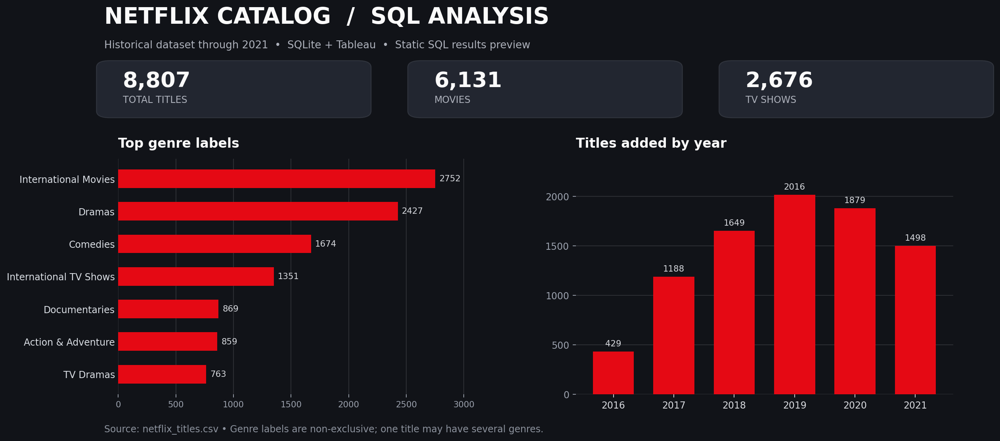

# Netflix Content Analysis | SQL + Tableau

Exploratory analysis of a **historical Netflix movies and TV shows dataset**, using **SQLite** for data cleaning and analysis and **Tableau** for interactive visualisation.

The project examines the composition of the catalog, trends over time, content ratings, genre distribution and production countries. The data is a **historical snapshot ending in 2021**, not a live view of Netflix's current catalog.



> **Visual note:** The image above is a static summary generated from the SQLite tables, **not a screenshot of the Tableau dashboards**. **[Explore the interactive Tableau Public workbook](https://public.tableau.com/app/profile/anna.huk/viz/NetflixContentAnalysisSQLTableau/GeographicRatingAnalysis)**, or download the packaged workbook from [`tableau/netflix_dashboard.twbx`](tableau/netflix_dashboard.twbx).

## Interactive Tableau dashboard

**[View Netflix Content Analysis on Tableau Public](https://public.tableau.com/app/profile/anna.huk/viz/NetflixContentAnalysisSQLTableau/GeographicRatingAnalysis)**

The published workbook brings together two analyses: **Content Trends & Genres** and **Geographic & Rating Analysis**. Use the workbook navigation to switch between the views when sheet tabs are enabled. The link opens the Geographic & Rating Analysis view directly.

## Key findings

| Metric | Result |
|---|---:|
| Total titles | **8,807** |
| Movies | **6,131 (69.6%)** |
| TV shows | **2,676 (30.4%)** |
| Most frequent genre label | **International Movies (2,752 titles)** |
| Most frequent production-country label (excluding unknown) | **United States (3,690 titles)** |
| Most titles recorded as added in | **2019 (2,016 titles)** |

**Interpretation:** A title can have **multiple** genre labels and production countries. Genre and country totals are therefore **not mutually exclusive**, and their sums can exceed 8,807. These figures describe this dataset only, not Netflix's entire current library.

## Tools and techniques

- **SQLite / SQL** — cleaning, `CASE` / `COALESCE`, recursive common table expressions (CTEs), joins, aggregation and window functions.
- **Tableau** — two interactive dashboards with nine worksheets, including a country map, genre heatmap, content-type breakdown, ratings and time trends.
- **DB Browser for SQLite** — optional graphical interface for running the `.sql` scripts.

## Repository structure

```text
netflix-content-analysis-sql-tableau/
├── README.md
├── assets/
│   └── catalog_overview.png
├── sql/
│   ├── 00_create_raw_table.sql     # Optional schema for new DB
│   ├── 01_prepare_data.sql        # Repeatable cleaning + splitting
│   └── 02_analysis.sql            # Exploratory and analytical queries
├── data/
│   ├── netflix.db                 # Ready-to-use SQLite database
│   ├── raw/
│   │   └── netflix_titles.csv     # Original dataset
│   └── processed/
│       ├── netflix_clean.csv      # Tableau source table
│       ├── genres.csv             # One row per title / genre label
│       └── countries.csv          # One row per title / country label
└── tableau/
    └── netflix_dashboard.twbx     # Packaged Tableau workbook + extract
```

## How to explore the SQL analysis

**Fastest option (no import required):** Open [`data/netflix.db`](data/netflix.db) in [DB Browser for SQLite](https://sqlitebrowser.org/). Open and run [`sql/02_analysis.sql`](sql/02_analysis.sql) in its **Execute SQL** tab.

To rebuild the cleaned and split tables, run [`sql/01_prepare_data.sql`](sql/01_prepare_data.sql) against the provided database first. This script drops and recreates the three *derived* tables (`netflix_clean`, `genres`, `countries`); it does **not** remove `netflix_titles`.

Alternatively, if the `sqlite3` command-line tool is installed:

```bash
sqlite3 -header -column data/netflix.db < sql/02_analysis.sql
```

To create a fresh database **from the provided raw CSV** with the SQLite CLI (Bash / macOS / Linux; run from the repository root):

```bash
sqlite3 data/netflix_rebuilt.db < sql/00_create_raw_table.sql
printf '.mode csv\n.import --skip 1 data/raw/netflix_titles.csv netflix_titles\n' | sqlite3 data/netflix_rebuilt.db
sqlite3 data/netflix_rebuilt.db < sql/01_prepare_data.sql
```

The third command creates the same analytical table structure. SQLite 3.32+ supports `.import --skip 1`. You can also import the CSV through DB Browser for SQLite if you prefer a graphical workflow.

## How to open the Tableau dashboards

1. Download [`tableau/netflix_dashboard.twbx`](tableau/netflix_dashboard.twbx).
2. Open it in a compatible Tableau application. The `.twbx` package contains the Tableau workbook **and its embedded data extract**.
3. Explore the two dashboards. They include views for catalog composition, country and genre comparisons, ratings and time trends.
4. If you want to **refresh or replace** the extract, reconnect the workbook to the CSV files in [`data/processed/`](data/processed/), using `show_id` for relationships. The original un-packaged workbook referenced local Windows file paths; the published package has been cleaned of those paths.

**Compatibility note:** The workbook includes an external visualisation extension. Some interactive elements may require an internet connection, Tableau extension approval or a compatible Tableau version. The packaged file has been checked for archive/XML integrity, but it has **not been independently opened in Tableau** in this environment.

**Interactive portfolio link:** [Open the published Tableau Public workbook](https://public.tableau.com/app/profile/anna.huk/viz/NetflixContentAnalysisSQLTableau/GeographicRatingAnalysis). GitHub displays the included image and downloadable `.twbx` file; it does not automatically render a Tableau workbook interactively.

## Data preparation and analytical questions

The preparation script standardises missing country and rating values as `Unknown`, extracts `year_added` from date strings and separates comma-delimited genres and countries into two lookup tables via **recursive CTEs**. The analysis script explores:

- Movie versus TV show composition and content ratings.
- Annual title additions, their percentages and cumulative totals.
- Genre and production-country rankings.
- Genre trends over release years and across selected countries.

Example query from the project:

```sql
WITH yearly AS (
    SELECT year_added, COUNT(*) AS titles_added
    FROM netflix_clean
    WHERE year_added IS NOT NULL
    GROUP BY year_added
)
SELECT
    year_added,
    titles_added,
    SUM(titles_added) OVER (ORDER BY year_added) AS cumulative_titles
FROM yearly
ORDER BY year_added;
```

## Data source and limitations

Dataset: [Netflix Movies and TV Shows — Kaggle](https://www.kaggle.com/datasets/shivamb/netflix-shows) (**CC0 / Public Domain**, according to the dataset listing). The supplied snapshot contains 8,807 rows and 12 original fields.

The data does not track real-time additions, removals or Netflix's current catalog. `year_added` reflects the last year of the dataset's `date_added` text field, rather than the film's original release year. Missing or malformed values are not reconstructed from external sources. Multi-valued genres and production countries are counted once per label associated with a title.

This repository is an independent data analysis exercise and is not affiliated with Netflix or Tableau.
